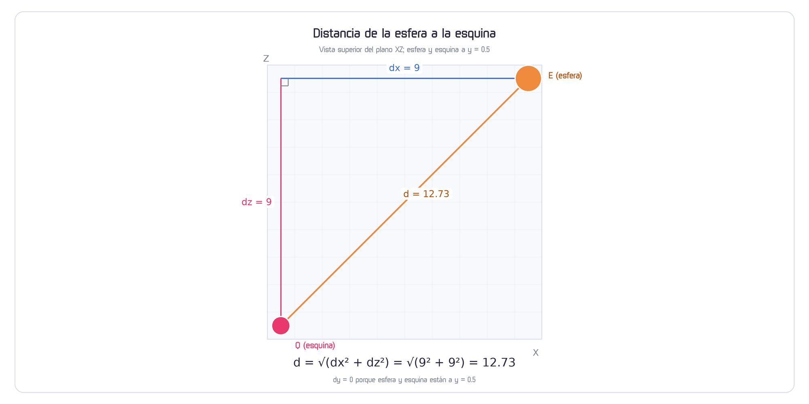
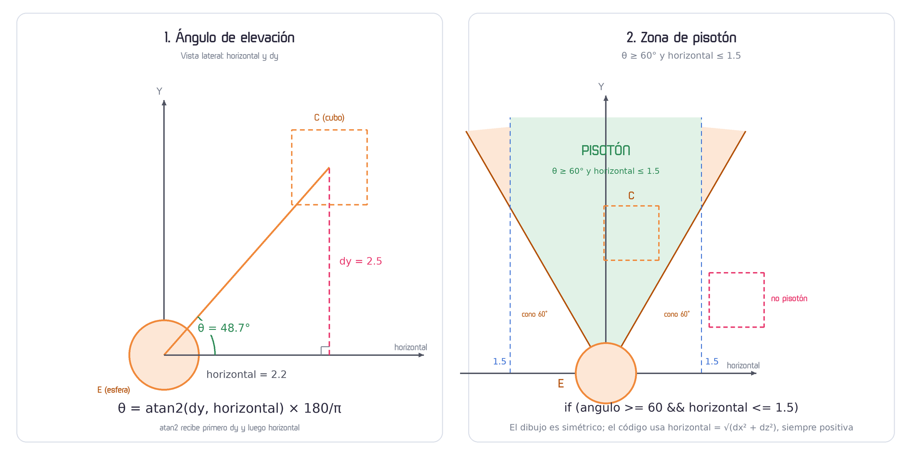

# Enemigo esfera: patrulla, distancia y pisotón

**Proyecto base:** `T8/T8.5.2-unity-intro-2/Unity_Intro_2/Unity_Intro_2` (el salto ya está programado).
**Implementación:** `T8/T8.6.1-matematicas-basicas/Unity_Intro_3/Unity_Intro_3/Assets/EnemigoEsfera.cs`.
**Escena:** `T8/T8.6.1-matematicas-basicas/Unity_Intro_3/Unity_Intro_3/Assets/Scenes/SampleScene.unity`.

Esta guía describe **lo que está implementado**, no una versión ideal. La esfera usa solo las matemáticas necesarias: distancia, normalización y `atan2`. No hay victoria ni derrota, no hay giro visual y no hay persecución.

## Qué hace la implementación

1. La esfera aparece en una esquina al azar.
2. Se mueve en línea recta hacia la esquina objetivo.
3. Cada **5 segundos** cambia el índice de la esquina objetivo.
4. Si llega a menos de `0.1` de la esquina, elige otra esquina distinta.
5. Si el cubo está dentro del radio horizontal y el ángulo de elevación es al menos `60°`, escribe `PISOTON` y reubica la esfera en una esquina aleatoria.

| Concepto | Dónde aparece |
|---|---|
| Distancia | `Longitud(hacia)` para llegar a la esquina; `horizontal` en `Pisoton` |
| `atan2` | Ángulo de elevación del cubo en `Pisoton` |
| Resta de vectores | `objetivo - transform.position` y `cubo.position - transform.position` |
| Suma de vectores | `posición nueva = posición actual + dirección * paso` |
| Normalización | `Normalizar(hacia)` para que la diagonal no sea más rápida |

---

## Fase 0 — Escena y campos

El plano primitivo de Unity mide **10 × 10** y está centrado en `(0, 0, 0)`. Sus esquinas reales están en `(±5, 0, ±5)`.

La esfera primitiva mide 1 de diámetro, así que su radio es `0.5`. Para que su **centro** no salga del plano, las esquinas de patrulla se meten `0.5` hacia adentro: `±4.5`.

| Objeto | Configuración |
|---|---|
| `Plane` | Primitivo 10 × 10 en `(0, 0, 0)` |
| `Enemigo` | `Sphere` escala 1, posición inicial `(4.5, 0.5, 4.5)`, `Rigidbody` con **Is Kinematic**, `SphereCollider` radio `0.5`, script `EnemigoEsfera` |
| `Cube` | Cubo 1 × 1 × 1, `Rigidbody` no kinematic, `BoxCollider`, script `CubeMove` de T8.5.2 |
| `Canvas` | Texto TMP de caídas y botón que llama `CubeMove.ButtonClick()` |

La posición inicial del Inspector se sobrescribe en `Start`: la esfera salta a una esquina aleatoria.

Campos del script:

```csharp
public Transform cubo;
private Vector3[] esquinas;
public int indiceObjetivo;
public float velocidad = 5.0f;
public float distanciaContacto = 1.1f;
public float anguloPisoton = 60f;
```

Asigna el cubo a `cubo` en el Inspector. Si queda vacío, `cubo.position` lanza `NullReferenceException`.

**Valores usados en la escena:** `distanciaContacto` quedó en `1.5`; `anguloPisoton` usa el valor por defecto `60`. El valor del Inspector manda sobre el valor del script.

---

## Fase 1 — Las dos únicas funciones matemáticas

En `EnemigoEsfera.cs` solo hay dos funciones auxiliares de matemáticas. No existen `Restar`, `Sumar`, `Escalar` ni `Distancia`; esas operaciones se hacen directamente con el operador `-` de `Vector3` y con `new Vector3(...)`.

```csharp
static float Longitud(Vector3 v)
{
    return (float)Math.Sqrt(v.x * v.x + v.y * v.y + v.z * v.z);
}

static Vector3 Normalizar(Vector3 v)
{
    float longitud = Longitud(v);
    if (longitud < 0.0001f) { 
        return new Vector3(0f, 0f, 0f);
    }
    return new Vector3(v.x / longitud, v.y / longitud, v.z / longitud);
}
```

- `Longitud` calcula `√(x² + y² + z²)` con `System.Math.Sqrt`.
- `Normalizar` divide cada componente entre la longitud. Si la longitud es casi cero, devuelve el vector cero y evita dividir entre cero.
- `Vector3` se usa para guardar componentes y para restar o construir vectores; no se usan sus funciones de distancia o normalización. En este script no se usa `Vector3.Distance`, `.magnitude`, `Mathf.Sqrt` ni `Mathf.Atan2`.
- `CubeMove.cs` sí usa `movement.magnitude` y `Normalize()`; viene de T8.5.2 y no forma parte de este ejercicio.
- El archivo necesita `using System;` para `Math`. `UnityEngine` aporta `Vector3`, `MonoBehaviour` y `Time`.

### Cálculo de la distancia

La distancia completa entre dos puntos es:

```text
d = √(dx² + dy² + dz²)
```

Si los dos puntos están a la misma altura (`dy = 0`), se reduce a:

```text
d = √(dx² + dz²)
```

Para el pisotón se usa esa misma distancia horizontal:

```text
horizontal = √(dx² + dz²)
```

La altura `dy` **no** entra en `horizontal`; se usa después, en el ángulo. En `Pisoton` se calcula directo, no con `Longitud`, porque `Longitud` incluiría `dy`.



**Figura 1.** La esfera `E` y la esquina `Q` están a la misma altura (`y = 0.5`), así que la distancia es la hipotenusa en el plano XZ: `d = √(dx² + dz²)`. Para el cubo se usa la misma distancia horizontal; su altura `dy` se trata en la Figura 2.

Ejemplo numérico con la esfera en una esquina y la esquina opuesta:

```text
E = (4.5, 0.5, 4.5)
Q = (-4.5, 0.5, -4.5)
dx = -9, dy = 0, dz = -9
d = √(81 + 0 + 81) = √162 = 12.73
```

Ejemplo con el cubo:

```text
E = (0, 0.5, 0)
C = (4, 1.5, 3)
dx = 4, dz = 3
horizontal = √(16 + 9) = 5.0
dy = 1.0
```

Con `horizontal = 5.0` el cubo está fuera del radio de contacto; este ejemplo solo muestra cómo se calcula la distancia, no un pisotón.

---

## Fase 2 — Patrulla entre esquinas

### 2.1 Guardar las esquinas y elegir la primera

```csharp
void Start()
{
    esquinas = new Vector3[4];
    esquinas[0] = new Vector3(-4.5f, 0.5f, -4.5f);
    esquinas[1] = new Vector3( 4.5f, 0.5f, -4.5f);
    esquinas[2] = new Vector3( 4.5f, 0.5f,  4.5f);
    esquinas[3] = new Vector3(-4.5f, 0.5f,  4.5f);

    // setup de la primera esquina
    NewRandom();
    transform.position = esquinas[indiceObjetivo];

    InvokeRepeating("NewRandom", 0f, 5f);  // cambiar de esquina cada 5 segundos
}

void NewRandom()
{
    indiceObjetivo = UnityEngine.Random.Range(0, 4); 
}
```

- `UnityEngine.Random.Range(0, 4)` devuelve enteros `0, 1, 2, 3`; el límite superior es exclusivo.
- Se escribe `UnityEngine.Random`, no `Random`, porque `using System;` también trae `System.Random` y el compilador se confunde.
- `NewRandom()` elige la esquina inicial y `transform.position` coloca la esfera ahí.
- `InvokeRepeating("NewRandom", 0f, 5f)` repite el cambio cada 5 segundos. El primer disparo ocurre casi de inmediato (primer frame) porque el retardo es `0f`; como `NewRandom()` ya se llamó antes, el índice puede cambiar otra vez justo al inicio. No es un error: la esfera aparece en la primera esquina elegida, pero el objetivo efectivo pasa a ser la segunda elección.
- El nombre del método va como texto. Si cambias `NewRandom` de nombre, cambia también el string de `InvokeRepeating`.
- `NewRandom` **puede repetir** la misma esquina. Si el índice no cambia, la esfera sigue hacia donde iba.

### 2.2 Mover la esfera

```csharp
void MoverEsfera()
{
    Vector3 objetivo = esquinas[indiceObjetivo];
    Vector3 hacia = objetivo - transform.position;
    float distancia = Longitud(hacia);

    if (distancia < 0.1f)
    {
        // Elige otra esquina distinta: suma 1, 2 o 3 y da la vuelta
        indiceObjetivo = (indiceObjetivo + UnityEngine.Random.Range(1, 4)) % 4;
        return;
    }

    Vector3 direccion = Normalizar(hacia);
    float paso = velocidad * Time.deltaTime;

    transform.position = new Vector3(
        transform.position.x + direccion.x * paso,
        transform.position.y,                       // la altura no cambia
        transform.position.z + direccion.z * paso
    );
}
```

Paso a paso:

1. `objetivo` es la esquina actual.
2. `hacia = objetivo - posición` es el vector que falta recorrer. Es una resta directa, sin función auxiliar.
3. `Longitud(hacia)` mide ese vector. Como la esfera y las esquinas están a `y = 0.5`, la distancia 3D coincide con la horizontal.
4. Si la distancia es menor a `0.1`, la esfera ya llegó. Elige otra esquina con un desplazamiento de `1, 2` o `3` y da la vuelta con `% 4`. Ese desplazamiento nunca es `0`, así que la esquina nueva es distinta. Después hace `return` para no mover ese frame.
5. `Normalizar(hacia)` convierte el vector en dirección unitaria. Sin normalizar, en una diagonal de 45° la esfera avanzaría `√2 ≈ 1.41` veces más rápido.
6. `paso = velocidad * Time.deltaTime` es la distancia recorrida en este frame.
7. La posición nueva es la actual más `direccion * paso`. La `y` se conserva para que la esfera no se eleve.

El `Time.deltaTime` es obligatorio: sin él, la velocidad depende de los FPS.

**No implementado:** el giro visual de la esfera (`transform.Rotate`) y el método `MostrarDistancias`. La esfera se traslada sin rodar; no es un error de la mecánica.

---

## Fase 3 — De `Contacto` a `Pisoton`

### 3.1 La versión comentada de `Contacto`

En el archivo quedó comentada la primera versión, que solo medía distancia 3D:

```csharp
// bool Contacto()
// {
//     Vector3 haciaCubo = cubo.position - transform.position;
//     float distanciaCubo = Longitud(haciaCubo);
//
//     if (distanciaCubo <= distanciaContacto)
//     {
//         return true;
//     }
//     return false;
// }
```

`Contacto` detecta cualquier acercamiento entre los centros, pero **no distingue** si el cubo está arriba, al lado o abajo. Un golpe lateral también entra en el umbral. Por eso se conserva como paso didáctico y se reemplaza por `Pisoton`.

### 3.2 Por qué el pisotón necesita dos condiciones

| Condición | Fórmula en el código | Qué evita |
|---|---|---|
| Ángulo mínimo | `angulo >= anguloPisoton` | Que un cubo al lado o abajo cuente como pisotón |
| Radio horizontal | `horizontal <= distanciaContacto` | Que un cubo lejano pero muy alto cuente como pisotón |

Las dos condiciones deben cumplirse. Juntas forman un **cono** de ángulo mínimo recortado por un **cilindro** de radio `distanciaContacto`; no es una esfera de contacto.

---

## Fase 4 — Cálculo del ángulo del pisotón

### 4.1 Código implementado

```csharp
bool Pisoton()
{
    Vector3 haciaCubo = cubo.position - transform.position;
    float dx = haciaCubo.x;
    float dy = haciaCubo.y;
    float dz = haciaCubo.z;

    float horizontal = (float) Math.Sqrt(dx*dx + dz*dz);  // distancia horizontal
    float angulo = (float)(Math.Atan2(dy, horizontal) * 180.0 / Math.PI); // angulo vertical

    if (angulo >= anguloPisoton && horizontal <= distanciaContacto){
        Debug.Log("PISOTON");
        Reset();
        return true;
    }
    return false;

}
```

Línea por línea:

1. `haciaCubo = cubo.position - transform.position` es el vector que va del centro de la esfera al centro del cubo.
2. `dx`, `dy`, `dz` son sus componentes.
3. `horizontal = √(dx² + dz²)` elimina la altura y deja la distancia vista desde arriba.
4. `Math.Atan2(dy, horizontal)` calcula el ángulo de elevación. Recibe **primero `dy`** y **luego `horizontal`**. Devuelve radianes; por eso se multiplica por `180 / π`.
5. La condición exige ángulo suficiente **y** distancia horizontal suficiente.
6. Si se cumple, escribe `PISOTON`, llama a `Reset()` y devuelve `true`.

`anguloPisoton = 60` significa **60° medidos desde la horizontal**, no desde la vertical. El cubo debe estar dentro de los 30° alrededor de la vertical.

Como `horizontal` es una raíz cuadrada, siempre es no negativa. El ángulo queda entre `-90°` y `90°` para un cubo arriba o abajo. `atan2` maneja bien el caso `horizontal = 0`; no hay división entre cero.

La condición de radio usa `horizontal`, no la distancia 3D. Por eso el código no impone una altura máxima: un cubo muy alto pero dentro del radio y del cono podría contar. En el juego real la altura está limitada por el salto.

El contacto físico entre la esfera (radio `0.5`) y una cara del cubo (medio lado `0.5`) ocurre a `1.0` entre centros; si el cubo está rotado, puede ser algo mayor. El valor de la escena, `distanciaContacto = 1.5`, es un margen didáctico; la comprobación es matemática y no usa `OnCollisionEnter`.

### 4.2 Figura del ángulo y de la zona de pisotón



**Figura 2.** Izquierda: el ángulo `θ` sale de `atan2(dy, horizontal)`; el cubo se dibuja punteado en `C`. Derecha: la zona verde cumple `θ ≥ 60°` y `horizontal ≤ 1.5`. La zona naranja es la parte del cono que queda fuera del radio; el cubo punteado rosa no cumple las condiciones. El dibujo se recorta arriba; el código no impone una altura máxima.

El ejemplo de la izquierda (`48.7°`) queda por debajo del umbral; sirve para ver la fórmula, no para un pisotón.

El dibujo es simétrico para explicar el cono. En el código, `horizontal = √(dx² + dz²)` siempre es no negativa; el lado izquierdo y el derecho se combinan en esa única distancia.

### 4.3 Ejemplos numéricos

Con `anguloPisoton = 60` y `distanciaContacto = 1.5`:

| Caso | `horizontal` | `dy` | `angulo` | ¿Pisotón? |
|---|---:|---:|---:|---|
| Justo encima | 0 | 1.0 | 90° | Sí |
| Arriba y cerca | 0.5 | 1.0 | 63.4° | Sí |
| Arriba y lejos | 1.0 | 1.0 | 45° | No: falta ángulo |
| Al lado | 1.0 | 0 | 0° | No |
| Abajo | 0 | -1.0 | -90° | No |
| Borde del radio | 1.5 | 2.6 | 60° | Sí, en el límite |

Observa el tercer caso: `horizontal = 1.0` sí está dentro del radio, pero el ángulo de `45°` no alcanza el umbral. Por eso no basta con la distancia.

La tabla evalúa la condición matemática del código, no el contacto físico entre colliders. Algunos casos, como el borde del radio, pueden cumplir la condición sin que el cubo toque la esfera.

### 4.4 Cuánta altura exige el umbral

Para que el ángulo llegue a `60°`, la altura mínima crece con la distancia horizontal:

```text
dy mínimo = horizontal * tan(60°)
```

| `horizontal` | `dy` mínimo | Centro del cubo en `y` (esfera en `y = 0.5`) |
|---:|---:|---:|
| 0.5 | 0.87 | 1.37 |
| 1.0 | 1.73 | 2.23 |
| 1.5 | 2.60 | 3.10 |

Cuanto más lejos del centro, más alto debe estar el cubo. Con un salto normal, el radio efectivo del pisotón es menor que `distanciaContacto`; el valor `1.5` no significa que todo el cilindro sea alcanzable. Calibra `distanciaContacto` y `anguloPisoton` en el Inspector con el salto real del cubo.

### 4.5 `Reset` después del pisotón

```csharp
void Reset()
{
    NewRandom();
    transform.position = esquinas[indiceObjetivo];
}
```

Al detectar el pisotón, la esfera no desaparece ni termina el juego: elige una esquina aleatoria y se teletransporta. El `InvokeRepeating` sigue activo, así que el objetivo puede cambiar otra vez a los 5 segundos.

Dos detalles del código actual:

- `NewRandom()` puede devolver la **misma** esquina donde está la esfera. En ese caso la esfera no se mueve y, si el cubo sigue cumpliendo las dos condiciones, el `Debug.Log("PISOTON")` puede repetirse en cada frame. No hay bandera `resuelto` que lo impida.
- `Reset()` también es el nombre de un mensaje del Editor de Unity. Si agregas el componente desde cero o usas “Reset” en el Inspector, Unity puede llamarlo antes de `Start()` y `esquinas` todavía es `null`. Si aparece ese error, el método puede llamarse `Reubicar()`.

### 4.6 `Update`

```csharp
void Update()
{
    MoverEsfera();
    // Contacto();
    Pisoton();
}
```

El orden es: primero mover la esfera, luego comprobar el pisotón. `Contacto()` está comentada. `Pisoton()` se llama en cada frame, pero su valor de retorno se ignora; el `bool` queda disponible para una victoria o derrota futura.

---

## Fase 5 — Base `CubeMove` de T8.5.2

El proyecto base es `Unity_Intro_2` (T8.5.2). El salto ya está programado y **no se modificó** para este ejercicio.

Lo que ya trae `CubeMove.cs`:

- `jumpForce = 5.0f`.
- `estaEnSuelo` para evitar saltar en el aire.
- `OnCollisionEnter` que marca suelo cuando el cubo choca con `Plane`.
- `caidas`, `cayendo` y el texto TMP del HUD.
- `ButtonClick()` para reiniciar la posición y la rotación del cubo cuando cae.

El salto es:

```csharp
if (keyboard.spaceKey.wasPressedThisFrame && estaEnSuelo == true)
{
    rb.AddForce(Vector3.up * jumpForce, ForceMode.Impulse);
    estaEnSuelo = false;
}
```

La detección de suelo es:

```csharp
private void OnCollisionEnter(Collision collision)
{
    if (collision.gameObject.name == "Plane")
    {
        estaEnSuelo = true;
    }
}
```

`estaEnSuelo` solo se activa al chocar con `Plane`. Si el cubo queda sobre la esfera, no recupera el salto hasta tocar el piso.

`CubeMove` no tiene `juegoTerminado`, `Ganar()` ni `Perder()`. El enemigo tampoco guarda una referencia a `CubeMove`; solo lee `cubo.position`.

---

## Fase 6 — Orden de pruebas

| Prueba | Cómo | Resultado esperado |
|---|---|---|
| Matemáticas | `Debug.Log(Longitud(new Vector3(3, 0, 4)));` dentro del script | `5` |
| Normalización | `Debug.Log(Longitud(Normalizar(new Vector3(3, 0, 4))));` dentro del script | `1` |
| Patrulla | Comenta temporalmente `Pisoton()` en `Update` | La esfera va de esquina a esquina y cambia de objetivo cada 5 s |
| Contacto lateral | Camina contra la esfera a nivel del piso | No aparece `PISOTON` |
| Pisotón | Salta y cae sobre la esfera | Aparece `PISOTON` y la esfera se reubica en una esquina aleatoria (puede repetir la misma) |
| Borde | Salta cerca del borde de la esfera | El ángulo no alcanza `60°`; no hay pisotón |
| Temporizador | Espera 5 s sin tocar nada | El índice objetivo cambia; puede repetir la misma esquina |
| Calibración | Ajusta `distanciaContacto` y `anguloPisoton` en el Inspector | El pisotón se vuelve más fácil o más estricto |

No hay pantalla de “Ganaste” ni “Perdiste”. La única señal del pisotón es el log `PISOTON` y el teletransporte de la esfera.

---

## Errores comunes

- **`Random` ambiguo:** usar `UnityEngine.Random.Range`, no `Random.Range`.
- **`Math.Atan2` devuelve radianes:** multiplicar por `180 / Math.PI`.
- **Orden de `atan2`:** primero `dy`, luego `horizontal`. Al revés se calcula el ángulo complementario.
- **Confundir `horizontal` con la distancia 3D:** `horizontal` ignora `dy`; la altura se usa en el ángulo.
- **Usar `distanciaContacto` como distancia 3D:** en `Pisoton` se aplica a `horizontal`, no a `Longitud(haciaCubo)`.
- **Creer que `60°` es desde la vertical:** es desde la horizontal; equivale a 30° desde la vertical.
- **Olvidar `Time.deltaTime`:** la velocidad de la esfera cambia con los FPS.
- **La esfera se cae:** el `Rigidbody` debe tener **Is Kinematic** activado.
- **Las esquinas quedan fuera del plano:** usar `±4.5`, no `±5`.
- **`cubo` sin asignar:** `cubo.position` lanza `NullReferenceException`.
- **`InvokeRepeating` con el nombre viejo:** si renombras `NewRandom`, actualiza el string.
- **Esperar una esquina distinta del temporizador:** `NewRandom()` puede repetir el índice; solo la llegada a la esquina garantiza un índice distinto.
- **Esperar un solo `PISOTON`:** no hay bandera `resuelto`; `Reset()` puede dejar la esfera en la misma esquina y repetir el log.
- **Esperar que la esfera ruede:** el giro visual no está implementado; solo se traslada.
- **Esperar victoria o derrota:** no está implementado; solo hay log y `Reset()`.

---

## Ideas para ampliar el ejercicio (no implementadas)

Estas ideas **no** están implementadas en `Unity_Intro_3`:

- **Victoria/derrota:** usar el `bool` que devuelve `Pisoton()` para la victoria y una comprobación aparte (por ejemplo `Contacto()`) para la derrota; mostrar UI y detener el juego.
- **Giro visual de la esfera:** `transform.Rotate` con `ángulo = distancia recorrida / radio`.
- **Persecución:** cambiar el objetivo de la esquina al cubo cuando esté cerca, conservando la altura.
- **Mostrar distancias:** imprimir las cuatro distancias a las esquinas con `Debug.Log`.

Si se agregan después, la base matemática sigue siendo la misma: restar, medir, normalizar y sumar.
