# Tema 1. Metodologías ágiles en el desarrollo de software

Resumen basado en **Sommerville, *Software Engineering*, 9.ª ed. (2011)**, caps. 2, 3, 4 y 5.
Las páginas citadas son las del libro (no las del PDF).

> **Cómo leer este resumen**
> - El texto normal viene del libro.
> - Los bloques marcados con **🟡 Complemento** son información que agrego claoude, porque el libro Sommerville no cubre ese punto o lo cubre solo en parte.

---

## 1.4 Proceso completo de desarrollo de software

Un **proceso de software** es el conjunto de actividades para crear un sistema. 

Siempre incluye cuatro actividades básicas: **especificación, desarrollo, validación y evolución** (p. 28).

### Modelo en cascada (p. 30–32)

Las fases van una tras otra. Cada fase termina con un documento aprobado y la siguiente no empieza hasta que la anterior termina.

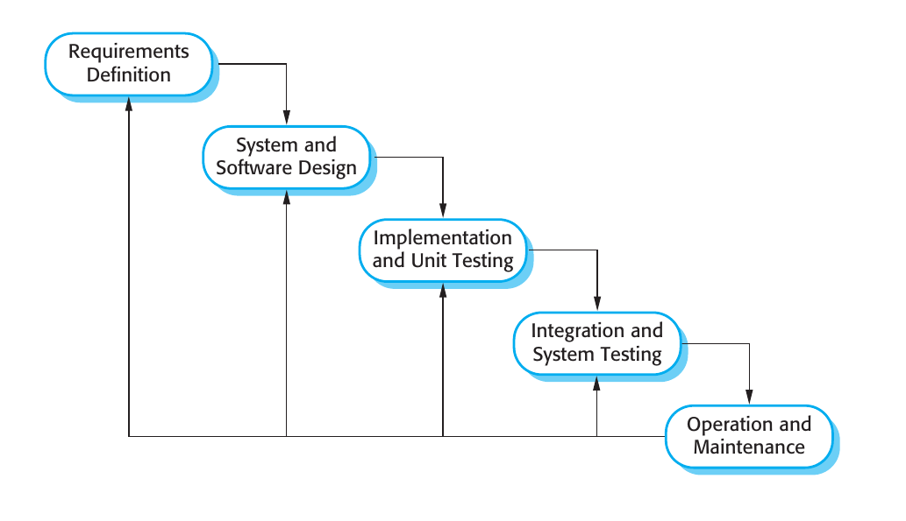

| Fase | Qué se hace |
|---|---|
| 1. Requerimientos | Se define con los usuarios qué debe hacer el sistema. |
| 2. Diseño | Se define la arquitectura y las partes del sistema. |
| 3. Construcción (implementación) y pruebas unitarias | Se programa y se prueba cada parte por separado. |
| 4. Integración y pruebas del sistema | Se unen las partes y se prueba todo junto. Luego se entrega. |
| 5. Operación y mantenimiento | El sistema se usa. Se corrigen errores y se agregan funciones. Es la fase más larga. |

- **Ventaja:** el avance es visible; hay documentos en cada fase.
- **Problema:** es rígido. Cambiar requerimientos a mitad del proyecto cuesta mucho.
- **Úsalo solo si** los requerimientos son claros y casi no van a cambiar.

### Desarrollo incremental (iterativo) (p. 32–34)

Se construye una primera versión, el cliente la revisa y se mejora en varias versiones. Especificar, desarrollar y validar ocurren **al mismo tiempo**, no en fases separadas.

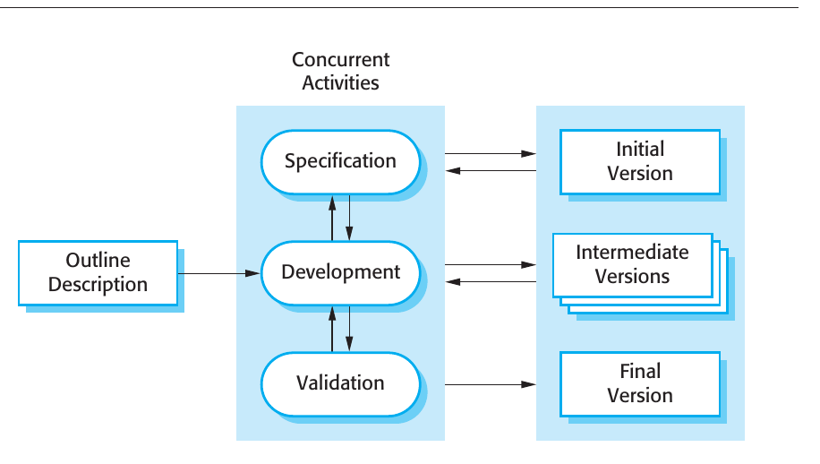

**Ventajas frente a cascada:**
1. Cambiar requerimientos cuesta menos.
2. El cliente da retroalimentación sobre software real, no sobre documentos.
3. El cliente usa partes útiles del sistema antes.

**Problemas:**
1. El avance es menos visible (hay menos documentos).
2. La estructura del código se degrada si no se mejora (refactoriza) con frecuencia.

> 🟡 **Complemento — Relación con el reto:** en el reto se trabaja de forma **iterativa** (sprints), pero se recorren las mismas fases: requerimientos (T1), diseño (T2), construcción (T5–T6), pruebas (T3), despliegue (T4) y mantenimiento.

---

## Qué es el desarrollo ágil (p. 58–62)

Los métodos ágiles son métodos **incrementales** que buscan entregar software funcionando rápido, con poca burocracia y con el cliente involucrado.

### Cómo surgió Agil (p. 57–59)

- **Años 80 y principios de los 90:** se creía que el mejor software salía de una **planeación cuidadosa**, mucha documentación y procesos rígidos. Esta idea venía de proyectos **enormes y de larga vida**: sistemas aeroespaciales y de gobierno, con equipos grandes en varias empresas. Ej.: el software de control de un avión puede tardar hasta **10 años** desde la especificación hasta el uso.
- **Años 80:** IBM introduce el desarrollo incremental y aparecen lenguajes que permiten construir software más rápido.
- **El problema:** al aplicar esos procesos "pesados" a sistemas de negocio pequeños y medianos, se gastaba más tiempo en **planear y documentar** que en programar y probar. Además, el mercado cambia rápido: cuando el software por fin se entregaba, los requerimientos ya eran otros y el sistema podía ser inútil.
- **Finales de los 90:** por esa frustración, varios desarrolladores proponen métodos "ligeros": **DSDM**, **Scrum** y **XP (programación extrema)**. Todos se enfocan en el software mismo y no en su documentación.
- Estos métodos comparten una filosofía que se resume en el **Manifiesto ágil**.

**Manifiesto AGIL.**

| Más esto… | …que esto |
|---|---|
| Individuos e interacciones | Procesos y herramientas |
| Software que funciona | Documentación extensa |
| Colaboración con el cliente | Negociación de contratos |
| Responder al cambio | Seguir un plan |

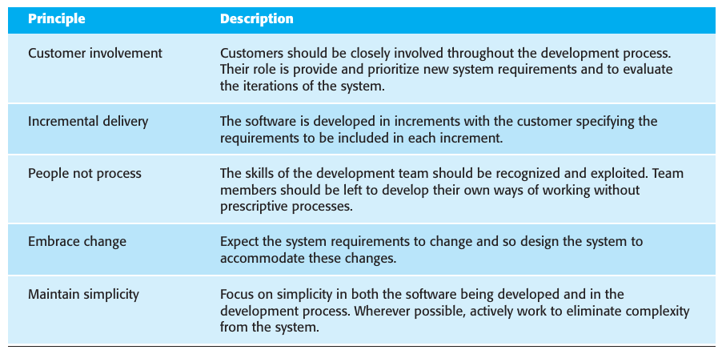

### Ágil vs. dirigido por un plan (p. 62–64)

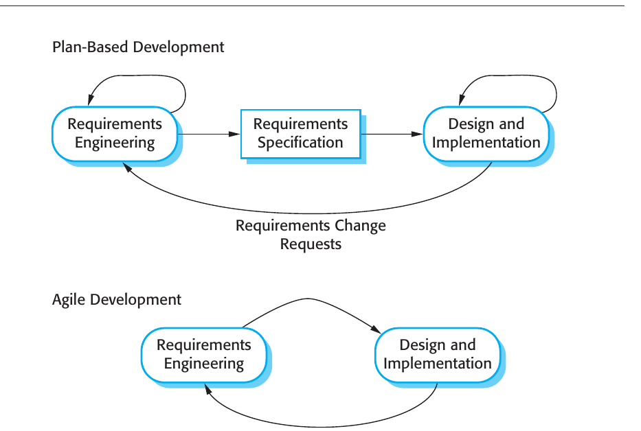

- **Dirigido por plan:** primero se escribe la especificación completa y luego se diseña y programa.
- **Ágil:** requerimientos y diseño se hacen **juntos**, en cada iteración.

### ¿Por qué ágil funciona bien en proyectos pequeños y medianos? (p. 59)

Metodologias agiles tienen éxito sobre todo en:
1. **Productos pequeños o medianos** que una empresa desarrolla para vender.
2. **Sistemas internos** de una organización, cuando el cliente se compromete a participar y **no hay muchas reglas o regulaciones externas**.

La razón: ágil depende de un **equipo pequeño que trabaja junto** y se comunica de forma informal (hablando, no con documentos). Con pocas personas eso funciona: todos saben qué pasa, los cambios se ajustan rápido y el cliente ve avances cada pocas semanas.

### ¿Por qué no tanto en proyectos grandes o empresas grandes? (p. 74–77)

**Sistemas grandes:**
- Son **varios sistemas** conectados, hechos por **equipos distintos**, Nadie puede ver el sistema completo y la comunicación informal ya no alcanza.
- Deben **integrarse con sistemas que ya existen**; esos requerimientos no son flexibles.
- Gran parte del trabajo es **configurar e integrar**, no programar desde cero; la integración continua se vuelve casi imposible.
- Tardan **años**; la gente cambia de proyecto y se pierde el conocimiento que no se documentó.
- Tienen **muchos stakeholders**; es imposible involucrarlos a todos.
- Por eso necesitan **más diseño previo y documentación** (arquitectura, base de datos, reparto del trabajo entre equipos).

**Empresas grandes:**
- Los gerentes sin experiencia en ágil no quieren arriesgarse.
- Tienen **procedimientos de calidad y estándares** obligatorios que chocan con ágil. Ej.: cada cambio debe aprobarse antes (choca con refactorizar libremente) o un equipo externo hace las pruebas (choca con TDD).
- El nivel técnico del personal es muy variado, y ágil funciona mejor con gente experimentada.
- Hay **resistencia cultural**; cambiar la cultura toma años.

**Contratos:** en ágil la especificación se hace poco a poco, así que es difícil firmar un contrato por un sistema con requerimientos fijos. Se paga por tiempo, y si hay problemas surgen disputas sobre quién paga (p. 61).

### ¿Y en software crítico? (cohetes, sondas espaciales, aviones, equipo médico) (p. 57, 60, 64)

**para sistemas críticos de seguridad, el enfoque dirigido por plan es el mas adecuado**, porque se necesita un **análisis completo** del sistema antes de construirlo. Ágil requiere **modificaciones importantes** para usarse aquí. Motivos:
- Hay que analizar a fondo la **seguridad, la confiabilidad y la protección** antes de programar.
- Los sistemas de **tiempo real** con tiempos estrictos necesitan un diseño detallado previo (monitor cardiaco, maquina de dialisis, maquina de inyeccion de insulina, software de un satelite ).
- Un **regulador externo** debe aprobar el software (ej.: la FAA para aviones). Para eso se exige **documentación detallada** que demuestre que el sistema es seguro (el *safety case*).

> 🟡 **Complemento — por qué es tan delicado, con ejemplos reales:**
> - **No hay "siguiente sprint":** una sonda en Marte no se puede reiniciar ni parchar con facilidad, y un cohete solo se lanza una vez. La filosofía ágil de "entregar rápido y corregir después" no aplica cuando un error destruye la misión o cuesta vidas.
> - **El costo de un error es enorme:**
>   - **Ariane 5 (1996):** el cohete explotó a los 37 segundos del despegue. El código reutilizado del Ariane 4 convertía un número de 64 bits a 16 bits y se desbordó. Pérdida: unos 370 millones de dólares.
>   - **Mars Climate Orbiter (1999):** se perdió la sonda porque un equipo usaba unidades inglesas (libras-fuerza) y otro unidades métricas (newtons). Fue un error de **requerimientos e interfaces** entre equipos.
>   - **Therac-25 (años 80):** una máquina de radioterapia dio sobredosis a pacientes por un error de concurrencia en el software. Hubo muertes.
> - **Estándares obligatorios:** la aviación usa **DO-178C** y la NASA tiene sus propias normas de software. Piden trazabilidad completa: cada requerimiento debe enlazarse con su diseño, su código y su prueba. Eso exige mucha documentación formal.

**Resumen cuando Agil y cuando Proyecto planeado:**

| | Ágil | Dirigido por plan |
|---|---|---|
| Tamaño del equipo | Pequeño, en el mismo lugar | Grande o distribuido |
| Requerimientos | Cambian seguido | Estables y bien conocidos |
| Costo de un error en producción | Bajo: se corrige en el siguiente sprint | Muy alto: vidas, misiones, millones |
| Regulación externa | Poca o ninguna | Fuerte (aviación, salud, espacio) |
| Ejemplos | Apps, sitios web, videojuegos, startups | Cohetes, sondas, aviones, equipo médico, bancos centrales |

---

## 1.1 Iteraciones en el desarrollo ágil (Basado en Scrum)

(p. 72–74):

> 🟡 Scrum es un marco de trabajo ágil. Scrum se enfoca en **administrar** el proyecto, no en prácticas de programación. para equipos pequeño entrega un producto en ciclos cortos y fijos llamados Sprints. Tiene 3 roles: Product Owner, Scrum Master y Developers. hacen reuniones seguido para revisar avances y adaptarse seguido.

> 🟡 Scrum viene del rugby: un scrum (en español "melé") es la jugada en la que todo el equipo se agrupa y empuja junto para avanzar con el balón.

- **Sprint:** periodo **fijo** de trabajo, normalmente de **2 a 4 semanas**. Al final se entrega un **incremento**: una parte del sistema que funciona. Mientras sucede este ciclo el equipo de trabajo se encierra y solo termina si la meta del Sprint se alcanza o si el plazo del Sprint se cumplio. 
- **Backlog de producto:** la lista de todo el trabajo pendiente del proyecto. Al inicio de cada sprint se revisa y se le asignan prioridades y riesgos. El cliente puede agregar requerimientos nuevos.
- **Historias de usuario** (XP, p. 65–67): los requerimientos se escriben como escenarios cortos en tarjetas. El equipo divide cada historia en **tareas** y estima el esfuerzo de cada una.

> - 🟡
> - **Meta del sprint:** una frase que dice qué valor entrega el sprint. Ej.: "El jugador puede registrarse e iniciar sesión".
> - **Backlog del sprint:** las historias que el equipo elige del backlog de producto para este sprint, divididas en tareas.
> - **Formato de historia de usuario:**
>   **Como** [tipo de usuario], **quiero** [acción], **para** [beneficio].
>   Ej.: *Como jugador, quiero guardar mi partida, para continuar después.*
> - **Velocidad del equipo:** cantidad de trabajo (normalmente en *puntos de historia*) que el equipo termina por sprint. Se usa el promedio de sprints pasados para planear cuánto meter en el siguiente.

---

## 1.2 Actores (roles de Scrum)

Los diferentes roles (personas) involucradas en un proyecto administrado con Scrum (p. 73–74):

- **Scrum Master:** es un **facilitador**, no un jefe. Organiza las reuniones diarias, da seguimiento al backlog, registra decisiones, mide el avance y se comunica con el cliente y la dirección. **Protege al equipo** de distracciones externas.
- **Equipo de desarrollo:** se organiza solo y decide cómo hacer el trabajo. Todos participan en la planeación de corto plazo.
- **Cliente:** participa de cerca. Da y prioriza requerimientos y evalúa cada entrega.
- **Stakeholder (parte interesada):** cualquier persona o rol afectado por el sistema (p. 87). Suelen tener necesidades distintas y a veces contradictorias.

> - 🟡 
> - **Product Owner:** dueño del backlog de producto. Decide **qué** se construye y en qué orden (prioridad). Representa a usuarios y stakeholders ante el equipo. Acepta o rechaza el trabajo terminado.
> - **Scrum Master:** cuida **cómo** es el mediador entre el equipo de desarrollo, clientes y managment. La jerarquia de un quipo de Scrum es flat; el **Scrum Master** es otro miembro mas del equipo 
> - **Equipo de desarrollo:** decide **cómo** construir y construye.
> - **Usuarios:** quienes usan el sistema. Son un tipo de stakeholder.

**NOTA.** Las reuniones en Scrum incluyen a todos los miembros. Todos los miembros deben de saber como funciona el software y que esta pasando, esto es para tener un mejor tiempo de reaccion cuando surgan problemas y para aportar ideas.  

---

## 1.3 Ejemplos de metodologías

### Scrum (p. 72–74)

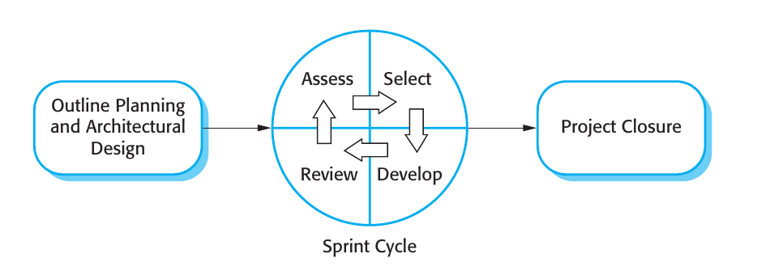

Tres fases: **planeación general** → **ciclos de sprint** → **cierre del proyecto**.

Dentro de cada sprint:
1. **Evaluar (Assess):** revisar el backlog de producto y priorizar.
2. **Seleccionar:** el equipo y el cliente eligen qué hacer en el sprint (*planeación*).
3. **Desarrollar:** el equipo trabaja. Hay **reuniones diarias** cortas (stand up meetings) donde cada uno dice qué hizo, qué problemas tuvo y qué hará (*daily*).
4. **Revisar:** al final se presenta el trabajo a los stakeholders (*revisión*).

### XP — Programación extrema (p. 64–72)

> 🟡 XP (Extreme Programming) es una metodología ágil, busca mejorar la calidad del software y la respuesta a cambios mediante prácticas técnicas como programación en parejas, desarrollo guiado por pruebas (TDD), integración continua, entregas pequeñas y frecuentes y refactorización constante, todo con mucha comunicación con el cliente.

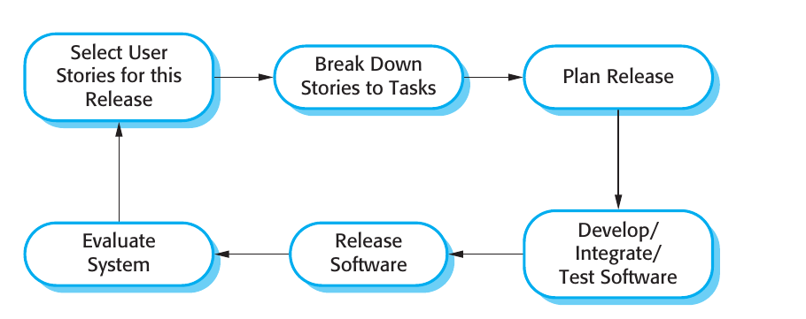 

(Figura 3.3 p. 65)

Prácticas principales de XP :

| Práctica | Idea |
|---|---|
| Historias de usuario | Requerimientos en tarjetas, divididas en tareas. |
| Entregas pequeñas | Primero lo mínimo útil; y se van a agregando funciones gradualmente. (2 semanas) |
| Diseño simple | Solo el diseño necesario para la funcion objetivo. |
| **Desarrollo guiado por pruebas (TDD)** | Se escribe la prueba automática **antes** del código. |
| Refactorización | Mejorar el código continuamente. (la mayoria de las veces es una simplificacion)|
| **Programación en pares** | Dos personas se revisan mutuamente. |
| Propiedad colectiva | Cualquiera puede cambiar cualquier parte del código. |
| Integración continua | Al terminar una tarea se integra y **todas** las pruebas deben pasar. |
| Cliente en sitio | Un representante del cliente forma parte del equipo. (idealmente) |

**Programación en pares — ventajas:** es un metodo de testeo en donde la del software se compartide, una revisión informal del código apoya la refactorización y reparte el conocimiento. (Ademas si uno de los dos renuncia hay menos riesgos de perder know-how).

### Criterios para elegir (p. 63–64)

Entre ágil y dirigido por plan:

- ¿Se necesita especificación y diseño muy detallados antes de programar? → **plan**.
- ¿Se puede entregar por partes y recibir retroalimentación rápida? → **ágil**.
- ¿Si equipo es pequeño y trabajan juntos? → **ágil**. ¿Es grande o distribuido? → **plan**.
- ¿El sistema necesita mucho análisis previo (tiempo real) o lo aprueba un regulador externo? → **plan**.
- ¿El equipo tiene buen nivel técnico? Ágil suele requerir más experiencia.

En la práctica, la mayoría de los proyectos **mezcla** prácticas de ambos.

---

## 1.5 Especificación de requerimientos

Un **requerimiento** son descripciones sobre lo que **qué debe** hacer un sistema computacional. Describe los los servicios y las restricciones de esos servicios. (p. 83).

### Niveles de requrimientos: (p. 83–84)

- **Requerimientos de usuario:** descripciones en lenguaje natural y diagramas simples, para el cliente, entienda lo que se las funciones que el servicio va a prestar y sus restricciones.
- **Requerimientos de sistema:** es una descripcion mucho mas detallada y precisa de las funciones, servicios, operaciones y sus restricciones, hecha para los desarrolladores.
 
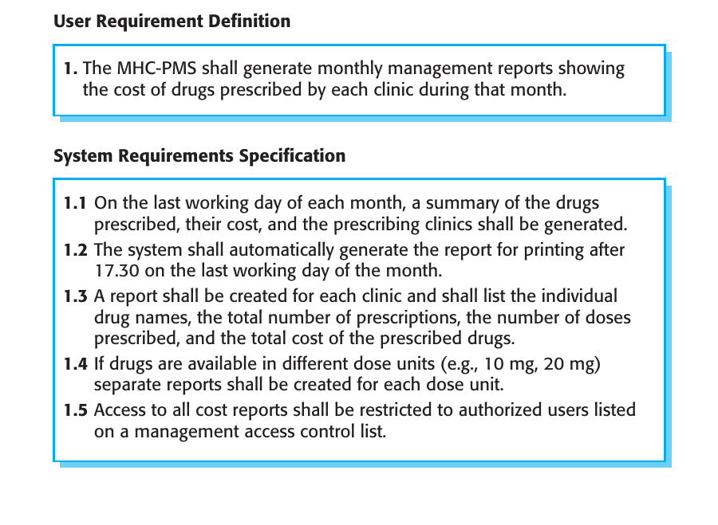x

### Tipos de requerimientos del sistema (p. 84–91)

- **Requerimientos de Sistema Funcionales:** es la descripcion de los servicios que da el sistema y cómo reacciona a entradas o salidas. Ej.: *"El sistema debe generar cada día la lista de citas de cada clínica."* (Cuentas,Control de Empleados, Nomina, Inventarios, Suministros, Facturacion, Reportes)
- **Requerimientos de Sistema No funcionales:** es la descripcion restricciones sobre el sistema completo y como funciona. Como: disponibilidad, Rendimiento, Tiempo de respuesta, Compatibilidad, portabilidad, etc. A menudo son **más críticos** que los funcionales: por que si fallan, todo el sistema puede llegar a fallar. (Ejemplos: Seguridad)

> 🟡 A veces un **requerimiento no funcional**, puede generar otros requerimientos funcionales. Ejemplo una restriccion no funcional para restringir el acceso a usuarios no autorizados (Seguidad), conlleva la implementacion de un sistema de inicio de sesion y control de usuarios que es un requerimiento funcional

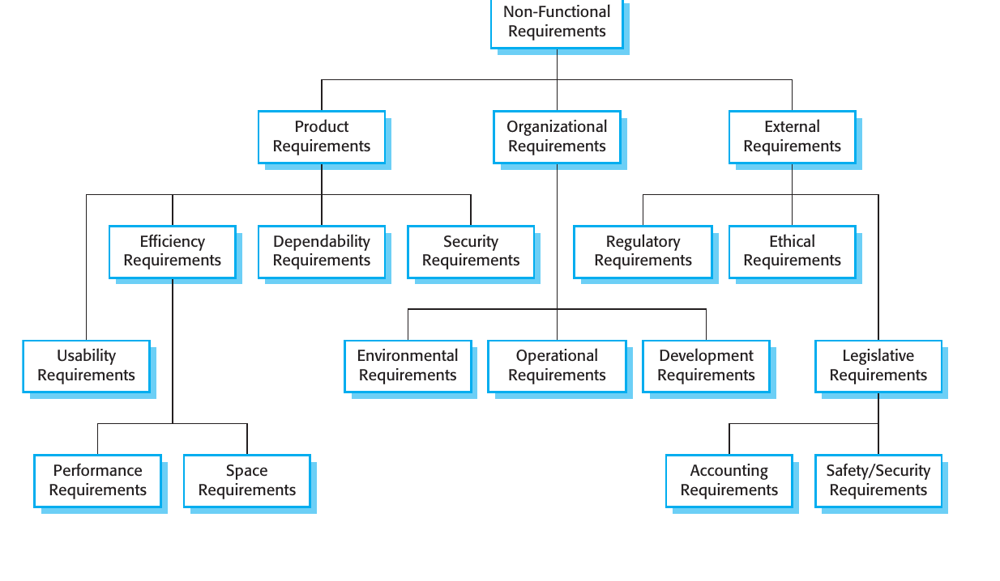 
(Figura 4.3 Tipos de requerimientos NO funcionales)

Se dividen en: **de producto** (velocidad, memoria, confiabilidad, seguridad, usabilidad), **de la organización** (lenguaje, herramientas, procesos) y **externos** (leyes, regulaciones, ética).

**Descripciones en terminos que se puedan medir.** Mal: *"El sistema debe ser fácil de usar."* Bien: *"Tras 4 horas de capacitación, el personal comete en promedio menos de 2 errores por hora."* (p. 89)

> 🟡 **Requerimientos de información:** Son los **datos** que el sistema debe guardar y manejar. Ej.: *"El sistema debe guardar de cada jugador: nombre de usuario, correo, fecha de registro y puntaje máximo."* Sirven después para diseñar la base de datos.

### Cómo redactar requerimientos (p. 95–96)  ME QUEDE AQUI

1. Usa un **formato estándar** para todos.
2. Distingue obligatorio (**"debe"**, en inglés *shall*) de deseable (**"debería"**, *should*).
3. Resalta las palabras clave.
4. Evita la jerga técnica.
5. Agrega la **razón** (por qué existe el requerimiento) y quién lo pidió.

### Estructura del documento (Fig. 4.7, p. 93)

Prefacio · Introducción · Glosario · Requerimientos de usuario · Arquitectura del sistema · Requerimientos de sistema · Modelos del sistema · Evolución del sistema · Apéndices · Índice.

> 🟡 **"estándar propietario":** es la normativa a la que se apega una empresa para definir  El estándar público más conocido es **IEEE 830** (hoy ISO/IEC/IEEE 29148), en el que se basa la estructura del libro. Usa la plantilla que indique el profesor.

### Atributos de un buen requerimiento (p. 86–87, 94, 110)

| Atributo | Significa |
|---|---|
| **Completo** | Están todos los servicios y restricciones que el usuario necesita. |
| **Consistente** | Ningún requerimiento contradice a otro. |
| **Verificable** | Se puede escribir una prueba que demuestre que se cumple. |
| **No ambiguo** | Solo se puede entender de una manera. |

Ejemplo de ambigüedad (p. 86): *"El usuario podrá buscar en las citas de todas las clínicas."* El médico quería buscar en todas a la vez; el programador hizo que primero se eligiera una clínica.

> 🟡 NOTA PERSONAL. La persona que esta a cargo de administrar los requerimientos (pasar de requerimientos de usuario a requerimientos del sistema) [Scrum Master], tendria que ser una alguien con perspicacia en el manejo de personas. Hay que tener mucho tacto tanto al tratar al cliente, como para delegar tareas. Scrum ayuda, por que asume que todo el equipo de trabajo esta imbolucrado en el proyecto, incluyendo el cliente; esto hace un poco mas facil para llegar a acuerdos. 

---

## 1.6 Casos de uso y diagramas de actividad

### Casos de uso (p. 106–108, 124–126)

Un **caso de uso** describe una interacción entre el sistema y un **actor** (persona u otro sistema).

- **Actor** → monito (figura de palo).
- **Caso de uso** → elipse con nombre.
- **Línea** → une al actor con el caso de uso.

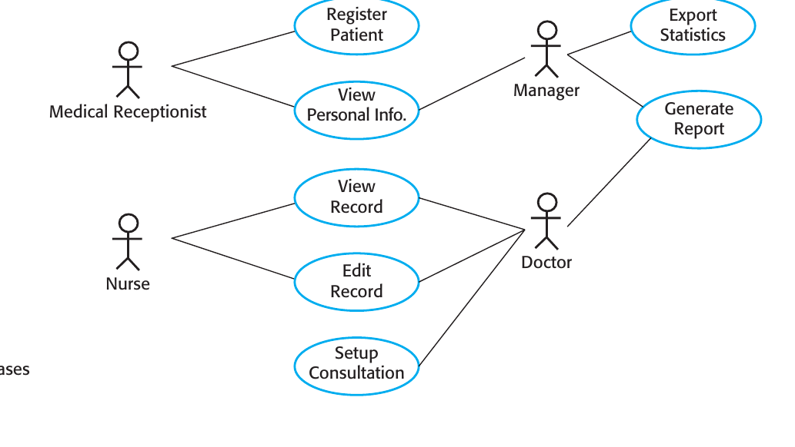

El diagrama solo da la vista general. Cada caso de uso se describe con texto o con una tabla:

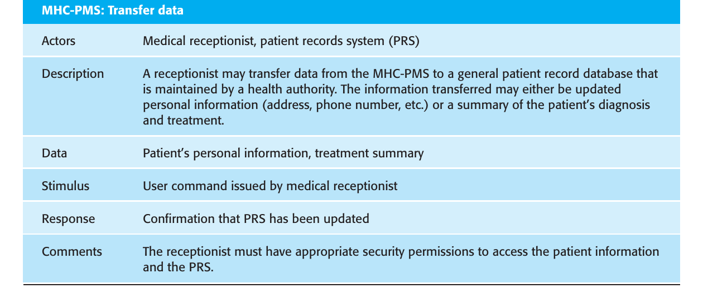

Un caso de uso agrupa varios **escenarios**: uno **normal** (principal) y uno por cada **excepción** (alternativos) (p. 107).

> 🟡 **Complemento — plantilla más completa que se usa en la práctica:**
>
> | Campo | Ejemplo |
> |---|---|
> | Nombre | Iniciar sesión |
> | Actor | Jugador |
> | **Precondición** (lo que debe ser cierto antes) | El jugador tiene una cuenta registrada. |
> | **Escenario principal** | 1. El jugador escribe usuario y contraseña. 2. El sistema valida los datos. 3. El sistema muestra el menú principal. |
> | **Escenarios alternativos** | 2a. Contraseña incorrecta: el sistema muestra un error y vuelve al paso 1. |
> | **Postcondición** (lo que es cierto al terminar) | El jugador tiene una sesión activa. |

### Diagramas de actividad (p. 122–123)

Muestran el **flujo** de un proceso: qué actividad sigue a cuál.

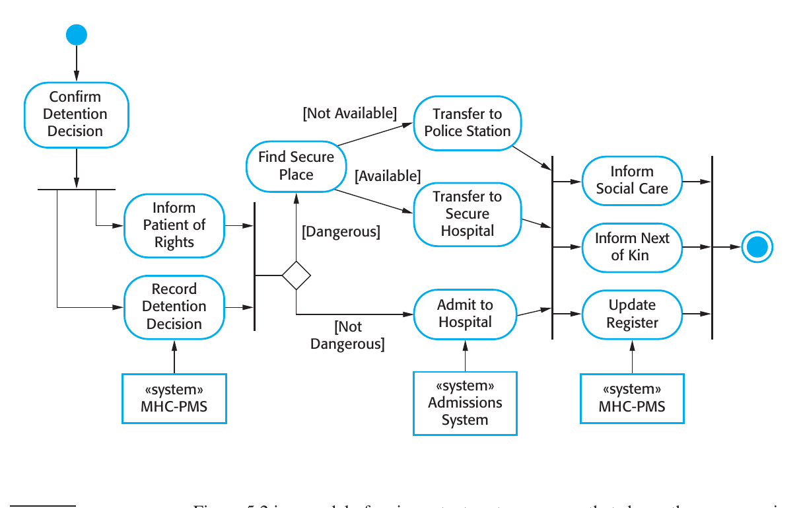

| Símbolo | Significa |
|---|---|
| Círculo relleno | Inicio |
| Círculo relleno dentro de otro círculo | Fin |
| Rectángulo redondeado | Actividad |
| Flecha | Flujo de una actividad a otra |
| Rombo | **Decisión**; cada salida lleva una **condición** entre corchetes, ej. `[Peligroso]` |
| Barra gruesa | Divide en actividades **paralelas** o espera a que **todas** terminen |

> 🟡 **Carriles (swimlanes):**  Son columnas (o filas) que dividen el diagrama según **quién** hace cada actividad. Ej.: carril "Jugador", carril "Sistema", carril "Base de datos". Así se ve claramente la responsabilidad de cada actor.

---

## 1.7 Importancia de la especificación orientada al usuario

(p. 110–111):

- Un error en los requerimientos es **mucho más caro** de corregir que un error de diseño o de código. Cambiar un requerimiento obliga a cambiar el diseño, el código y repetir las pruebas.
- Por eso se **validan** los requerimientos con el cliente. Se revisa:
  - **Validez:** ¿es lo que el usuario realmente necesita?
  - **Consistencia:** ¿hay contradicciones?
  - **Completitud:** ¿falta algo?
  - **Realismo:** ¿se puede construir con la tecnología, el tiempo y el dinero disponibles?
  - **Verificabilidad:** ¿se puede probar?
- **Técnicas:** revisiones con el cliente, **prototipos** que el usuario prueba y escribir los **casos de prueba** desde los requerimientos.
- Los requerimientos **siempre cambian**: el cliente entiende mejor el problema conforme avanza el proyecto.

> 🟡 **Complemento — costo según la fase:** estudios clásicos (Boehm, entre otros) muestran que corregir un error cuesta cada vez más mientras más tarde se detecta. Como referencia aproximada:
>
> | Se detecta en… | Costo relativo |
> |---|---|
> | Requerimientos | 1× |
> | Diseño | ~5× |
> | Construcción | ~10× |
> | Pruebas | ~20–50× |
> | Producción (ya entregado) | ~100× o más |
>
> Los números exactos varían según el estudio; lo importante es la tendencia. Esta es la razón de mostrarle al usuario prototipos y entregas tempranas: **es más barato equivocarse al principio**.

---

## Resumen en una frase por subtema

- **Historia:** ágil nace en los 90 como reacción a procesos pesados; se formaliza con el Manifiesto ágil (2001).
- **Cuándo usarlo:** ágil para equipos pequeños y requerimientos cambiantes; plan para sistemas grandes, regulados o críticos.

- **1.1** Se trabaja en sprints cortos que toman historias del backlog y entregan algo que funciona.
- **1.2** Product Owner decide *qué*, Scrum Master facilita, el equipo decide *cómo*.
- **1.3** Scrum administra, XP da prácticas técnicas, Kanban controla el flujo.
- **1.4** Cascada = fases en orden; iterativo = todas las fases en ciclos cortos.
- **1.5** Requerimientos funcionales, de información y no funcionales: completos, consistentes, verificables y sin ambigüedad.
- **1.6** Casos de uso = quién hace qué con el sistema; diagramas de actividad = en qué orden.
- **1.7** Validar pronto con el usuario, porque un error de requerimientos cuesta más mientras más tarde se encuentra.
